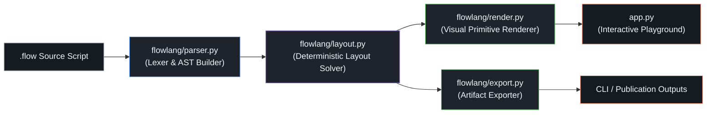

# Kurapika

**Kurapika** is a declarative Domain-Specific Language (DSL) and deterministic vector layout engine built from scratch in Python to compile plain-text `.flow` scripts into structured, publication-ready diagrams.

---

## Why Kurapika?

Manual diagramming tools trap system logic inside proprietary GUIs, while generic auto-layout tools often tangle complex workflows. **Kurapika** treats diagrams as deterministic, version-controllable source code—chaining nodes, control loops, and multi-actor lanes through a custom compilation pipeline so architectures can be diffed, parameterized, and rendered reliably.

---

## System Architecture



| Module | Role & Engineering Highlights |
| :--- | :--- |
| **`flowlang/parser.py`** | Custom lexer and recursive parser that compiles `.flow` syntax into a structured AST supporting control flow, variables, templates, grouping, swimlanes, and styling. |
| **`flowlang/layout.py`** | Deterministic spatial layout engine computing node geometry, hierarchical ranks, cross-lane alignment, and clean edge routing automatically. |
| **`flowlang/render.py`** | Visual rendering engine decoupling logical graph topology from custom themes and styling directives. |
| **`flowlang/export.py`** | Multi-format exporter serializing compiled diagrams into portable output artifacts. |
| **`flowlang/__main__.py`** | CLI entrypoint (`python -m flowlang`) for direct script compilation and batch execution. |
| **`app.py`** | Interactive web playground for writing `.flow` code, testing language constructs, and previewing compiled diagrams live. |
| **`tests/test_engine.py`** | Automated verification suite covering parser edge cases, layout invariants, and end-to-end compilation integrity. |

---

## Language Capabilities (`.flow` Syntax)

Every feature in **Kurapika** is demonstrated with working scripts in `examples/`:

* **Control Flow & Branching:** Sequential pipelines (`quickstart.flow`, `minimal.flow`), conditional cycles (`decision_loop.flow`), concurrent execution paths (`parallel.flow`), and retry loops (`ask_retry.flow`).
* **Structural Hierarchy:** Multi-actor **swimlanes** (`swimlanes.flow`), logical **node grouping** (`groups.flow`), and **multi-perspective views** (`views.flow`) from a single definition.
* **Programmable Workflows:** Reusable **variables** (`variables.flow`), iterative **template repetition** (`template_repeat.flow`), and declarative **custom styling** (`styling.flow`), combined in `full_feature.flow`.

---

## Quick Start

```bash
# 1. Clone the repository
git clone https://github.com/Innovatia-ignis-deva/Kurapika.git
cd Kurapika

# 2. Install dependencies
pip install -r requirements.txt

# 3. Launch the interactive web playground
python app.py

# Or run the test suite
pytest
```

---

## Repository Structure

```text
Kurapika/
├── app.py                  # Interactive web playground
├── requirements.txt        # Python dependencies
├── flowlang/               # Core compiler & layout engine package
│   ├── __init__.py
│   ├── __main__.py         # CLI execution interface
│   ├── parser.py           # Lexer & AST parser
│   ├── layout.py           # Spatial coordinate & routing solver
│   ├── render.py           # Visual rendering engine
│   └── export.py           # Output format exporter
├── examples/               # 12 working .flow language demonstrations
└── tests/
    └── test_engine.py      # Engine unit & integration tests
```

---

## Attribution & License

Licensed under the **Apache License, Version 2.0** ([LICENSE](LICENSE)). Created by **Devashrit Panda** (`Devashrit_the_omni`). Please credit authorship when referencing or building upon Kurapika.
